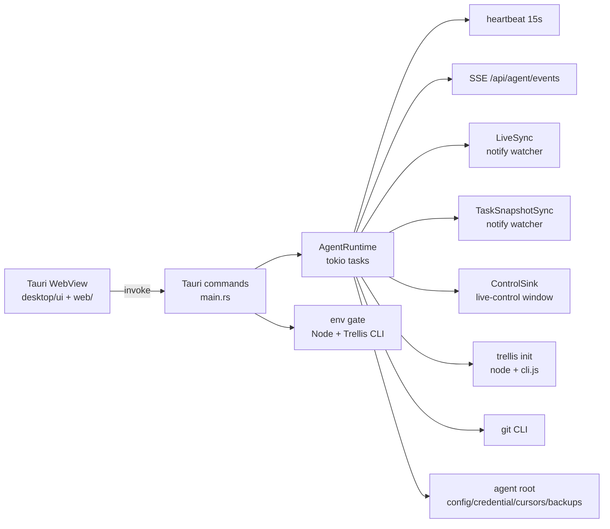
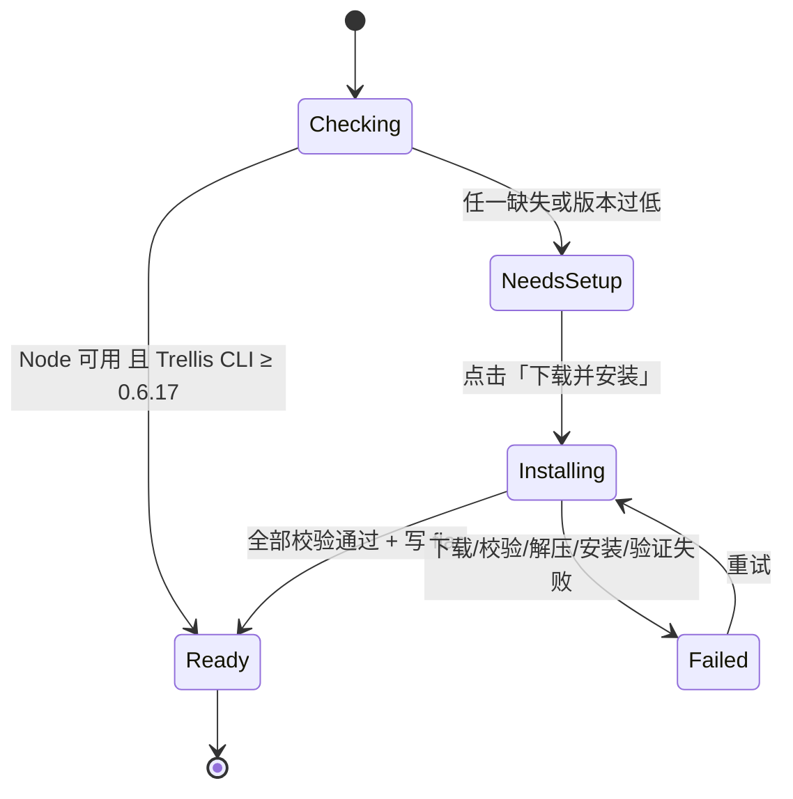

# Design: Rust in-process agent runtime (single-exe desktop client)

## 1. 运行模型

改造后进程拓扑：



- 不再有子进程、stdin 协议、stdout control 行、parent watchdog、单实例锁（改由进程内 `OnceLock` + 现有 `tauri-plugin-single-instance` 保证）。
- 前端契约不变：`main.rs` 的 Tauri 命令继续返回同样的 JSON 形状；`sidecar.rs` 的公开函数（`start/stop/restart/shutdown/toggle_pause/status/pending_control/pop_control/show_control/dismiss_control/decide_live_change/live_conflict_details/resolve_initial_sync/restore_live_backup`）保留为 `agent::runtime` 的薄封装，`main.rs` 改动最小。
- 控制事件不再走 stdout：JS 的 `emitControl(event)` 改为 `ControlSink::emit(Value)`，直接进入 `sidecar.rs` 现有的"去重入队 + `control_is_stale` + 弹 live-control 窗口"逻辑（该逻辑整体迁移到 `agent/control.rs`，判定键与 32 条队列上限不变）。

## 2. 模块划分

新目录 `desktop/src-tauri/src/agent/`（`sidecar.rs` 拆分后删除）：

| Rust 模块 | 对应 JS | 职责 |
|---|---|---|
| `protocol.rs` | `agent/protocol.js` | 常量（`PROTOCOL_VERSION=3`、`AGENT_VERSION`）、`AgentErrorCode`（39 个码，字符串序列化为 SCREAMING_SNAKE）、`AgentError{code,message}`、URL 归一化、ID/分支/配对码校验、`compare_versions`、enroll/heartbeat 响应解析、`validate_command`、`build_command_result`、`safe_error_message`、`is_path_inside` |
| `store.rs` | `agent/config-store.js` | `AgentPaths`（root/config/state/credential/lock/logs/hooks/live）、`ConfigStore`（schema 2，`update_config` 仅在变更时返回）、`agent_state`、事件 cursor、live cursor、suppression 文件、pending 目录；原子写（temp + rename，重试 10/25/50/100/200ms） |
| `credential.rs` | `agent/credential-store.js` | `windows` crate `CryptProtectData/CryptUnprotectData`（`CRYPTPROTECT_UI_FORBIDDEN`），落盘 `{schemaVersion:1, algorithm:"WindowsDPAPI-CurrentUser", ciphertext:<base64>, createdAt, updatedAt}`；凭证明文 ≥32 字符且无空白 |
| `http.rs` | `agent/api.js` | `reqwest` 客户端（rustls、Bearer、`user-agent: trellis-board-agent/<ver>`、可选 `caFile` PEM）；JSON 响应上限 1 MiB；快照传输上限 96 MiB；SSE `stream_events` 手写分帧（`event:`/`data:`/`id:`，缓冲上限 1 MiB，`last-event-id`）；全部 `/api/agent/*` 方法与 `health` |
| `process.rs` | `agent/process.js` | 白名单环境（PATH/PATHEXT/SystemRoot/WINDIR/ComSpec/TEMP/TMP/USERPROFILE/HOMEDRIVE/HOMEPATH/HOME/APPDATA/LOCALAPPDATA/SSH_AUTH_SOCK/PSModulePath）、超时（Windows 用 `taskkill /T /F` 结束进程树）、输出上限 1 MiB、`ProcessError` |
| `git.rs` | `agent/git-sync.js` | 固定参数 `-C <repo> -c core.hooksPath -c core.autocrlf=false -c http.sslVerify=true -c core.sshCommand=...`、分支操作追加 `-c core.fsmonitor=false`、操作白名单（show-toplevel/current-branch/head/git-path/status/status-paths/remote-url/ls-remote/ls-tree/fetch/rev-list/merge/check-ref/config-sparse）、`GIT_STATE_MARKERS`、`GIT_TERMINAL_PROMPT=0`/`GCM_INTERACTIVE=Never`/`GIT_ASKPASS=""` |
| `onboarding.rs` | `agent/project-onboarding.js` | `inspect_project`、`initialize_project`（仅在缺 `.trellis/tasks` 或所选工具缺失时调 `trellis init`）、`check_initial_push`（`waiting_commit`/`branch_missing`/`unable_to_verify`/`pushed`）、`preflight_project`、`attach_project` |
| `trellis_cli.rs` | `desktop/sidecar/trellis-runtime.js` | 解析 `node.exe`/`npm.cmd`/`trellis.cmd`（PATHEXT）、`npm root -g` 探测、`npm install -g --prefix <dataDir>/npm-global @mindfoldhq/trellis@0.6.17`、执行 `<node.exe> <cli.js> init -y --skip-existing -u <devId> <tool flags>`（超时 210s，cwd=项目根） |
| `device.rs` | `desktop/sidecar/desktop-device.js` | `validate_*`、`parse_session_cookie`、`login_desktop`、`logout_desktop_session`、`enroll_with_token`、`enroll_desktop_device`、`revoke_desktop_device`、`read_local_associations`、`read_agent_identity` |
| `association.rs` | `desktop/sidecar/desktop-association.js` | `associate_desktop_project`、`preflight_desktop_project`、`format_association_error` |
| `live_sync.rs` | `agent/live-sync.js` | 实时同步：`update_bindings`、watcher 事件合并、`_dirty_live_paths`（git diff + untracked + `.trellis/.developer`）、路径/扩展名白名单、preflight→decision→upload、pending 批次持久化、`_apply_remote_files`（备份 + `remote_overwrite` + 原子写 + suppression）、`decide_pending_live_change`（continue/takeover/cancel）、`restore_live_backup`、`cleanup_backups`（20 份/30 天） |
| `task_sync.rs` | `agent/task-snapshot-sync.js` | 任务快照同步：cursor（revision/sequence/baselines/deferred/pending）、首次 `bootstrap/safe/review`、增量拉取、dirty 目录上传（含目录 rename 的 `movePair`）、429 退避、`TASK_FILE_CONFLICT` pending、`resolve_initial_sync`、`decide_conflict`（use-server/save-local-copy/overwrite-server）、`conflict_details`、`restore_backup` |
| `task_command.rs` | `agent/task-command.js` | `create_task`/`assign_task`/`sync_branch`/`refresh_status`：调用 `.trellis/scripts/task.py`（python）、git 状态检查、快照刷新后提交结果 |
| `runtime.rs` | `agent/index.js` | `AgentRuntime`：加载 config+credential+CA、`state.json` 状态机、15s 心跳、SSE 事件循环（`agent.revoked`/`task.changed`/`cursor.invalidated`/`command`）、`start_command`→执行→`submit_command_result`（重试 8/2）、401 触发 `AUTH_REVOKED` 停止、暂停/恢复、重启退避（替代 `MAX_RESTARTS=5`/`STABLE_RUN=60s`） |
| `env.rs` | 新增（无 JS 对应） | 环境门：Node 与 Trellis CLI 双检查、flag 快路径、PATH/`npm root -g` 探测、npmmirror 下载+sha256 校验+ZIP 解压、`node --version` 验证、`client.json.node_runtime`/`trellis_runtime` 读写、`runtime-progress` 事件 |
| `control.rs` | `sidecar.rs` control 部分 | 控制事件去重入队（32）、`control_is_stale`（`expiresAtEpochMs` + `pending-live/<pendingId>.json`）、弹窗/抑制/关闭 |
| `mod.rs` | — | 对外 façade，`pub use` 给 `main.rs` 调用 |

不移植：`agent/workspace.js`（模板下载/解压）、`agent/zip.js`、`agent/cli.js`、`shared/**` JS——仅 CLI 使用，不在桌面产品路径。`shared/task-snapshot.js` 的常量与分类算法（`TASK_SNAPSHOT_MAX_FILES=1024`、`MAX_FILE_BYTES=1 MiB`、`MAX_BATCH_BYTES=64 MiB`、`MAX_TRANSPORT_BYTES=96 MiB`、扩展名表、`normalizeSnapshotText`、`groupTaskSnapshotFiles`、`classifyTaskSnapshots`）在 `task_sync.rs` 内重写实现，服务端仍用 JS 版本，两端靠测试对齐。

## 3. 并发与错误策略

- tokio 多线程 runtime（`features = ["rt-multi-thread","macros","time","sync","fs","net"]`）；HTTP 与 SSE 为 async；文件读写用 `std::fs`（同步、体量小），在独立 `spawn_blocking` 中执行 git/powershell/npm 子进程。
- 每个 taskSpace/binding 一个 `tokio::sync::Mutex` 串行队列，等价 JS 的 `_enqueue`/`_runUploadWithSlot`；不同 binding 并行。
- 共享状态 `Arc<AgentState>`：`RwLock<Context>`（config/credential/bindings）+ `AtomicBool`（paused/stopping）。
- 错误统一 `AgentError{code,message}`；对外 Tauri 命令继续返回 `Result<T, String>`，JSON 里保留 `code`/`error` 字段。
- 发布配置 `panic = "abort"`：agent 代码禁止 `unwrap/expect/panic!/index panic`，所有外部输入解析失败转为 `AgentError(INVALID_RESPONSE)`；CI 加 `cargo clippy -- -D clippy::unwrap_used` 仅作用于 `agent/**`（允许既有 UI 代码例外）。

## 4. 文件监听

- `notify`（Windows `ReadDirectoryChangesW`），watch `<repo>/.trellis` 递归；只处理 `.trellis/.developer`、`.trellis/tasks/**`（不含 `archive/` 之外的规则与 JS 对齐）、`.trellis/workspace/**`，扩展名白名单同 `TASK_SNAPSHOT_EXTENSIONS`。
- 200 ms 合并窗口 + 每 project 一个待处理集合；自写抑制表带 TTL（JS 的 suppression 语义），避免回环上传。
- 停止/重启时 `drop` watcher 并 join；账号切换时清空 cursor/pending/suppression/backup（沿用现有契约）。

## 5. 首次启动环境门（Node + Trellis CLI）

### 5.1 检查项与状态

启动时依次检查两项，任一不满足即进入环境页：

| 检查项 | 通过条件 | 判定顺序 |
|---|---|---|
| Node.js | `node --version` ≥ 18.17.0 | `client.json.node_runtime.path` → PATH 上 `node.exe`（按 PATHEXT） |
| Trellis CLI | `@mindfoldhq/trellis` 版本 ≥ 0.6.17 | `client.json.trellis_runtime.cli_path` → `<dataDir>/npm-global/node_modules/...` → `npm root -g`（默认全局） → PATH 上 `trellis.cmd` |



常量（`env.rs`）：

```rust
pub const NODE_DOWNLOAD_VERSION: &str = "24.22.3";
pub const NODE_MIN_VERSION: &str = "18.17.0";
pub const TRELLIS_VERSION: &str = "0.6.17";
pub const NODE_ZIP_URL: &str =
  "https://registry.npmmirror.com/-/binary/node/v24.22.3/node-v24.22.3-win-x64.zip";
pub const NODE_ZIP_SHA256: &str =
  "e612af99f626ab415ea225af6bce5c971feb448cb5cae250bb1c3fa50c5f7d9f";
```

`runtime_status` 返回：

```json
{
  "state": "ready",
  "node": { "ok": true, "version": "24.22.3", "path": "<dataDir>\\node\\node.exe",
            "source": "client", "minVersion": "18.17.0" },
  "trellis": { "ok": true, "version": "0.6.17", "cliPath": "<dataDir>\\npm-global\\node_modules\\@mindfoldhq\\trellis\\bin\\trellis.js",
               "source": "client-prefix", "requiredVersion": "0.6.17" },
  "download": { "version": "24.22.3", "bytes": 37762649 }
}
```

- flag 快路径：`node_runtime.path` 与 `trellis_runtime.cli_path` 指向的文件都存在 → `Ready`，不启动子进程、不访问网络。
- flag 失效（文件被删）→ 清空对应字段后重新探测，自愈。
- Node 未命中 flag：PATH 探测，`node --version` 超时 5 s；版本过低返回 `node.ok=false` 并附 `foundVersion`（提示"检测到 v16.20.2，版本过低"），不修改系统 Node。
- Trellis 版本一律读 `<pkg>/package.json` 的 `version` 字段（不依赖 CLI 是否支持 `--version`），并要求版本 ≥ 0.6.17。

### 5.2 安装流程

按缺口执行，已满足的步骤不重复：

1. `node:download`：`reqwest` 流式下载到 `<dataDir>/downloads/node-v24.22.3-win-x64.zip.part`，每 ≥200 ms 或每 ≥1% 发 `runtime-progress {stage,received,total,percent}`。
2. `node:verify`：`sha2` 比对常量哈希；不一致删除 `.part` 并报 `NODE_DOWNLOAD_CORRUPT`。
3. `node:extract`：`zip` 解压，剥离 zip 内根目录 `node-v24.22.3-win-x64/`，写入 `<dataDir>/node.new`（存在先删）。
4. `node:validate`：运行 `<dataDir>/node.new/node.exe --version`（超时 10 s），必须 ≥ 18.17.0；随后删除旧 `<dataDir>/node` 并 `rename(node.new → node)`，删除 zip 与 `.part`。
5. `trellis:install`：`npm install -g --prefix <dataDir>/npm-global @mindfoldhq/trellis@0.6.17`（使用上一步确定的 node 自带 `npm.cmd` 或系统 `npm.cmd`；超时 300 s，输出落日志并截取末 2 KiB 作为错误摘要）。
6. `trellis:validate`：确认 `<dataDir>/npm-global/node_modules/@mindfoldhq/trellis/bin/trellis.js` 存在且 `package.json` 版本 ≥ 0.6.17。
7. 写 flag：`client.json` schema 3，`node_runtime`（仅下载安装成功时）与 `trellis_runtime {version, cli_path, source:"client-prefix"|"global", installed_at}`。
8. 发 `runtime-progress {stage:"ready", nodeVersion, trellisVersion}`。

失败处理：清理 `.part` 与 `node.new`，不写对应 flag，错误带阶段与原始原因（下载错误含 URL/状态码，npm 错误含末 2 KiB stderr）；「重试」从头执行缺口步骤。

### 5.3 数据模型（`client.json` schema 3）

```json
{
  "schema_version": 3,
  "server_url": "http://...",
  "username": "...",
  "password": "...",
  "node_runtime": {
    "version": "24.22.3",
    "path": "C:\\Users\\x\\AppData\\Roaming\\com.trellisboard.client\\node\\node.exe",
    "source": "downloaded",
    "installed_at": "2026-11-12T08:00:00Z"
  },
  "trellis_runtime": {
    "version": "0.6.17",
    "cli_path": "C:\\Users\\x\\AppData\\Roaming\\com.trellisboard.client\\npm-global\\node_modules\\@mindfoldhq\\trellis\\bin\\trellis.js",
    "source": "client-prefix",
    "installed_at": "2026-11-12T08:00:00Z"
  }
}
```

- `load()` 读到 schema 2 时补 `node_runtime`/`trellis_runtime` 为 `None` 并按 3 保存（不丢既有字段）。
- `node_runtime` 只记录下载安装的私有运行时；系统 Node 不写，避免 PATH 变化后误判。
- `trellis_runtime` 同时记录两种情况：客户端前缀安装（`client-prefix`）与用户机器已有全局安装（`global`）。

### 5.4 Tauri 命令与权限

| 命令 | 参数 | 返回 |
|---|---|---|
| `runtime_status` | — | 5.1 的 `{state, node, trellis, download}` |
| `runtime_install` | — | 成功后同 `runtime_status`（`state:"ready"`）；失败为 `Err(String)` |

- 进度事件：`runtime-progress`，payload `{stage, percent?, received?, total?, message?}`；前端用 `window.__TAURI__.event.listen('runtime-progress', …)`（`core:default` 已含 event 权限）。
- `permissions/desktop.toml` 新增 `allow-runtime-status`、`allow-runtime-install`；`capabilities/main.json` 同步加入。
- 并发保护：`runtime_install` 用 `Mutex<()>` 串行化，重复点击返回"正在安装"。

### 5.5 前端（`desktop/ui/`）

- `index.html` 拆两块：`#env-panel`（环境检查/安装）与 `#login-panel`（现有登录卡片，初始 `hidden`）。
- `#env-panel`：状态文案 + 两项检查结果（Node.js / Trellis CLI，显示版本或"未检测到"）+ 步骤列表（检查 Node.js / 检查 Trellis CLI / 下载 Node.js / 安装 Trellis CLI / 校验，`data-state=pending|active|done|failed|skipped`）+ 进度条 + 主按钮（下载并安装 / 重试 / 进入登录）。
- `setup.js`：启动时 `runtime_status` → `ready` 显示登录卡片并执行现有 `readStatus()`（含自动登录）；否则显示环境面板。安装过程订阅 `runtime-progress` 驱动步骤与百分比。
- 成功后展示"Node.js 24.22.3 · Trellis CLI 0.6.17 已就绪"与「进入登录」按钮；失败展示阶段与原因，按钮变「重试」。
- 不需要新窗口、新 capability 文件；`withGlobalTauri` 已开启。

### 5.6 与初始化流程的衔接

- `trellis_cli.rs` 统一用「node 路径 + cli.js 路径」直接执行：`<node.exe> <cli.js> init -y --skip-existing -u <devId> <tool flags>`，超时 210 s，cwd=项目根；不依赖 `trellis` 命令在 PATH 上。
- node 解析顺序：`client.json.node_runtime.path` → PATH `node.exe` → `CONFIG_MISSING`。
- cli.js 解析顺序：`client.json.trellis_runtime.cli_path` → `<dataDir>/npm-global/...` → `npm root -g` → PATH `trellis.cmd` 同级包目录。
- 初始化前若任一解析失败：清对应 flag → 环境页重新出现（不静默失败）。
- 系统 Node 与私有 Node 走同一套命令，只是可执行文件路径不同；不会修改用户机器的 PATH。

## 6. 打包

- `tauri.conf.json`：删除 `bundle.externalBin`、`bundle.resources`；保留 `targets: ["nsis"]`、`webviewInstallMode.downloadBootstrapper`（WebView2 由系统/安装器提供，属于操作系统层）。
- 删除 `desktop/sidecar/` 整个目录与 `desktop/src-tauri/binaries/`、`desktop/src-tauri/resources/`。
- `desktop/windows/hooks.nsh` 删除对 `trellis-agent.exe` 的清理段。
- `desktop/package-portable.ps1`：仅复制 `trellis-board-client.exe` + `VERSION.txt` + `SHA256SUMS.txt` + 使用说明。
- 版本 0.3.0（`package.json`、`tauri.conf.json`、`Cargo.toml`）。

## 7. 数据兼容

- `AgentPaths` 与 JS `createAgentPaths(root)` 完全一致（实现时逐字段对照 `agent/config-store.js` 命名，不得改名）。
- `config.json` schema 2、`state.json` schema 2、credential schema 1 保持读写兼容；旧 credential 直接解密复用，不触发重登。
- `client.json` 从 schema 2 升到 3（新增 `node_runtime`），旧文件自动迁移；`agent_root` 下文件一律不改名。
- live/task cursor 文件结构不变（`schemaVersion:1` + `taskSpaces{...}`），首次启动可直接续传。

## 8. 验证策略

- 单元测试（Rust）：protocol 解析/校验、路径与 symlink 防护、snapshot 分类与分组、SSE 分帧、原子写重试、DPAPI 加解密往返（本机 CurrentUser）、`env.rs` 版本比较与双 flag 快路径、sha256 失败分支。
- 集成测试（Rust `#[ignore]` + 手动/CI 脚本）：本地起 `server/index.js`，用真实账号登录 → enroll → 关联临时 git 仓库 → 改任务文件 → 断言服务端快照与本地一致；冲突路径断言备份目录与 `remote_overwrite` 控制事件。
- 手工验收：无 Node 且无 trellis 机器全链路（环境页 → 安装 → 登录 → 初始化）、已有 Node+trellis 机器直接进登录页、升级兼容、托盘暂停/恢复、控制窗四类确认。
