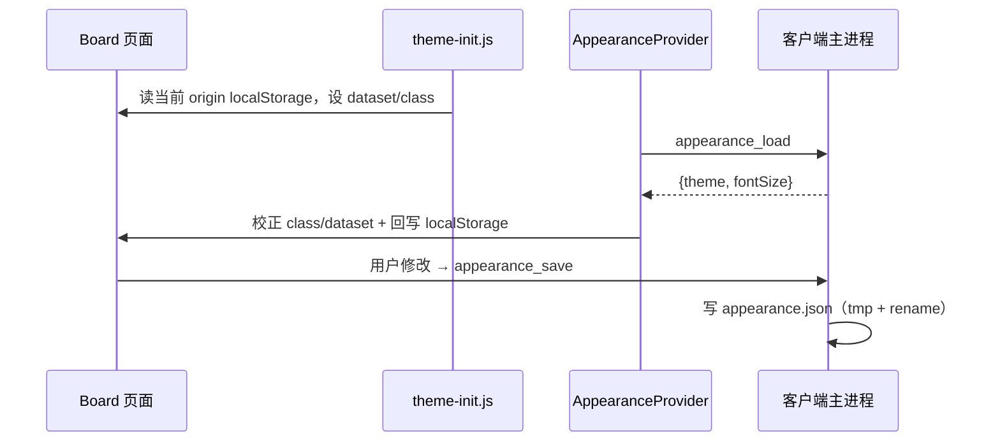

# 设计：客户端外观偏好跨 origin 持久化

## 数据与真源优先级

1. 设备偏好文件 `<dataDir>/appearance.json`（桌面客户端内最终真源）
2. 当前 origin 的 `localStorage`（首屏快速路径，浏览器内唯一真源）
3. `theme-init.js` 默认值 `system` / `md`

## Rust 侧（apps/desktop/src-tauri）

### 新模块 `src/appearance.rs`

```rust
pub const THEMES: [&str; 3] = ["light", "dark", "system"];
pub const FONT_SIZES: [&str; 4] = ["sm", "md", "lg", "xl"];

#[derive(Debug, Clone, PartialEq, Eq, Serialize, Deserialize)]
#[serde(rename_all = "camelCase")]
pub struct Appearance {
    pub theme: String,
    pub font_size: String,
}
```

- `Default`：`theme = "system"`、`font_size = "md"`（与 `apps/web/src/lib/appearance.js` 一致）。
- `fn normalised(self) -> Appearance`：值不在白名单即回落默认（逐字段独立判断）。
- `fn appearance_path() -> PathBuf`：`config::data_dir().join("appearance.json")`。
- `pub fn load() -> Appearance`：`NotFound` → 默认；`serde_json` 解析失败 → 默认；成功后 `normalised()`。
- `pub fn save(value: &Appearance) -> Result<(), String>`：沿用 `config::save` 的 `tmp + rename` 模式（`appearance.json.<pid>.tmp`），先 `config::ensure_directories()`。
- 单测：默认值、非法值归一、写入→读取往返、损坏 JSON 回落；用 `TRELLIS_DESKTOP_HOME` 指向临时目录（与 `config.rs` 现有测试同风格）。

### 命令（`src/main.rs`）

```rust
#[tauri::command]
fn appearance_load() -> appearance::Appearance;              // 只读，无敏感数据，不做 origin 校验

#[tauri::command]
fn appearance_save(
    app: AppHandle,
    window: WebviewWindow,
    theme: String,
    font_size: String,
) -> Result<(), String>;                                     // 先 ensure_board_caller(&app, &window)?
```

- `appearance_save` 的参数按 Tauri v2 的 camelCase 约定接收 `theme` / `fontSize`。
- 注册到 `invoke_handler` 列表（main.rs:916-942）。
- `mod appearance;` 加在模块声明区。

### 权限与 capability

- `permissions/desktop.toml` 追加：

```toml
[[permission]]
identifier = "allow-appearance-load"
description = "当前页面可读取本机外观偏好（只读，无敏感数据）。"
commands.allow = ["appearance_load"]

[[permission]]
identifier = "allow-appearance-save"
description = "当前已登录的 Board origin 可将主题与字号写入本机外观偏好。"
commands.allow = ["appearance_save"]
```

- `capabilities/board-local-association.json`（远程 Board）：`allow-appearance-load` + `allow-appearance-save`。
- `capabilities/main.json`（本地登录页）与 `capabilities/live-control.json`（实时同步控制窗口）：只加 `allow-appearance-load`；本地页面没有修改入口，写入权限不下发（挂载自动写入也被 `touched` 拦住，双保险）。

## Web 侧（apps/web/src/app/theme.tsx）

```ts
type DesktopInvoke = (command: string, args?: Record<string, unknown>) => Promise<unknown>

function desktopInvoke(): DesktopInvoke | undefined {
  const bridge = (window as unknown as { __TAURI__?: { core?: { invoke?: DesktopInvoke } } }).__TAURI__
  return typeof bridge?.core?.invoke === 'function' ? bridge.core.invoke : undefined
}
```

- 挂载 effect（`[]`）：存在桥时 `invoke('appearance_load')` → 校验返回值 → 若用户尚未交互（`useRef(false)` 的 `touched`）则 `setThemeState` / `setFontSizeState`。失败静默。
- `setTheme` / `setFontSize` / `resetAppearance` 内置把 `touched.current = true`。
- 新增 effect（`[theme, fontSize]`）：仅当 `touched.current` 为真且存在桥时 `invoke('appearance_save', { theme, fontSize }).catch(() => {})`——挂载时的初始值不回写设备偏好（本地页面无写入权限也不受影响）。
- 保持 `storePreference` 与 `readInitial*` 不变。

### 客户端自带页面

`apps/web/src/desktop/main-index.tsx` 与 `main-control.tsx` 用 `AppearanceProvider`（`@/app/theme`）包裹 `LoginApp` / `ControlApp`：

```tsx
createRoot(container).render(
  <AppearanceProvider>
    <LoginApp />
  </AppearanceProvider>,
)
```

- 两个页面的样式入口 `apps/web/src/desktop/desktop.css` 已 `@import '../index.css'`，因此 `html[data-font-size='*']` 的 rem 缩放与 `.dark` 主题变量自动生效，无需新增样式。
- 不挂 `AppProviders`（避免把 Tooltip/Toaster 带进登录窗口），只用 `AppearanceProvider`。

## 时序



## 风险

- 首帧闪烁：新 origin 首次加载可能先默认后校正（见 PRD Known Trade-offs）。
- 竞态：`appearance_load` 晚于用户点击 → `touched` 保护，避免把用户刚点的值覆盖掉。
- `ensure_board_caller` 依赖 `DesktopAuthState.board_url`，导航过程中调用会返回错误；`appearance_save` 失败必须静默（外观属于非关键路径）。
