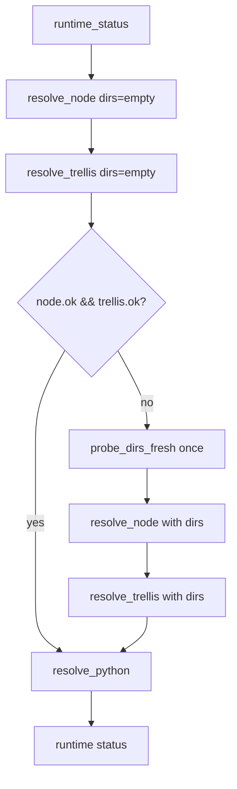

# 运行时环境检测收口 — Design

## 1. 总体思路

保持现有 `runtime_status` / `runtime_install` 命令契约不变，只调整 Rust 运行时解析内部：

1. `config::load()` 只读取 canonical `schemaVersion`，旧 `schema_version` 直接忽略；删除运行时层重复的旧键清理。
2. `check` / `install` 先做一次“仅用 flag / 私有前缀”的轻量解析；只有解析不完整时才执行一次 `probe_dirs_fresh()`。
3. Node 候选顺序改为 fresh PATH → 私有 runtime；Python 在需要重新发现时单独做 fresh `where python`。
4. npm 判断和 Trellis 安装共用同一份目录列表。

前端 `LoginApp` 不改；它仍在启动时调用 `runtime_status`，但 flag 命中时该调用不再启动 PowerShell。



## 2. F1：旧键直接忽略

`config::load()` 保持 direct serde：

1. 读文件、去 BOM；
2. `serde_json::from_str::<ClientConfig>`；
3. 失败返回 `Ok(None)`；
4. 继续执行现有 schema 版本迁移（2 → 3，未知版本 → `None`）。

不新增 `normalize_document`，不恢复 `schema_version` alias。只含旧键的文件按解析失败处理，明确不兼容。

`runtime_commands::normalize_schema_key` 删除；`runtime_status` 仍设置 `document["schemaVersion"] = config::SCHEMA_VERSION`，但不再专门清理旧键。`save()` 继续用 typed `ClientConfig` 序列化。

测试：不为旧键新增兼容测试；现有 camelCase 测试保持。

## 3. F2：延迟 fresh 探测

### 3.1 解析入口

在 `probe.rs` 新增（`pub(super)`）：

```rust
pub(super) async fn resolve_runtime<C: ClientConfigLike>(
    data_dir: &Path,
    config: &mut C,
) -> (NodeStatus, TrellisStatus, Vec<PathBuf>, bool) {
    let node = resolve_node(data_dir, config, &[]).await;
    let trellis = resolve_trellis(data_dir, config, &[]).await;
    if node.ok && trellis.ok {
        return (node, trellis, Vec::new(), false);
    }
    let dirs = probe_dirs_fresh().await;
    let node = resolve_node(data_dir, config, &dirs).await;
    let trellis = resolve_trellis(data_dir, config, &dirs).await;
    (node, trellis, dirs, true)
}
```

`check` 改为：

```rust
let (node, trellis, _dirs, _probed) = resolve_runtime(data_dir, config).await;
let python = resolve_python(config).await;
```

这样：

- 两个 flag/私有前缀都可用时，`probe_dirs_fresh()` 完全不执行。
- 只有 Node 或 Trellis 需要重新发现时，最多执行一次 PowerShell。
- 第一次轻量解析在 flag 失效时会清空 flag；第二次解析会重新探测并写回，行为与现状一致。
- 第一次解析若通过私有 runtime 自愈，`node.ok` 已为 true，不会为了“确认”再探测系统目录；这是 flag 缓存的既有取舍。

### 3.2 安装路径

`install` 同样先调用 `resolve_runtime`：

```rust
let (node_status, trellis_status, mut dirs) = resolve_runtime(data_dir, config).await;
let python_status = resolve_python(config).await;
let plan = install_plan(...);
```

后续：

- `plan.install_trellis` 且 `dirs.is_empty()` 时，才额外调用一次 `probe_dirs_fresh()`，因为需要找 npm；否则复用 `dirs`。
- `node_has_npm(&node_path, &dirs)`。
- `install_trellis(data_dir, &node_path, &dirs, &mut on_progress)`，内部删除重复的 `probe_dirs_fresh()`，只用传入目录。
- 不需要安装且不需要 npm 查找时，不执行 fresh 探测。

不引入全局缓存：`PATH` 在进程内基本不变，但静态缓存会让测试和“重新检查”不可预测；调用时机控制已经满足“不要让每次状态检查都等 PowerShell”。

## 4. F3：Node 候选顺序

`probe_dirs_fresh()`：

```rust
let mut dirs = where_node_dirs_fresh().await;
dirs.extend(probe_dirs());
dedupe_dirs(dirs)
```

`where.exe` 结果放到静态 PATH 快照之前，确保新装 Node 优先。

`resolve_node` 删除候选前的私有 runtime 提前返回块；候选构造改为：

```rust
let mut candidates = dirs.iter().map(|dir| (dir.join("node.exe"), "path"));
// 追加私有 runtime，按路径去重
```

私有 runtime 只在所有 `dirs` 候选都不可用时被尝试。仍保留“flag 丢失时通过私有 runtime 自愈”的能力。

flag 命中分支仍在候选扫描之前返回，保持启动快速路径；候选顺序只在需要探测时生效。注释同步改为“fresh PATH → 关注目录 → 私有 runtime”。

## 5. F4：npm 与来源字段

- `node_has_npm(node_path: &Path, dirs: &[PathBuf]) -> bool`：相邻 `node_modules/npm/bin/npm-cli.js` 检查不变；`find_in_path(dirs, "npm.cmd")` 替换 `path_dirs()`。
- `resolve_node` 的 flag 命中与版本过低分支使用真实来源：

```rust
let source = if flag.source.is_empty() { "client" } else { flag.source.as_str() };
```

- `install` 中 `reused_source` 若不再有调用点则删除；Node/Trellis/Python 直接使用 `status.source.unwrap_or(fallback)`，因为 `resolve_*` 已保留来源。
- 需要确认 `PythonRuntimeFlag.source` 与 `TrellisRuntimeFlag.source` 在当前结构里是否存在；不存在时保留现有 fallback，不虚构字段。

## 6. F5：Python fresh 探测

- 新增 `WHERE_PYTHON_SCRIPT`（`where.exe python.exe`）和 `where_python_dirs_fresh()`，复用 `run_process`、`WHERE_NODE_TIMEOUT` 的同类参数；`where_node_dirs` 的解析逻辑抽成 `where_executable_dirs(output, executable)` 供两者共用。
- `resolve_python` 的 flag 分支保留：有效则执行一次 `python_version_at` 校验并返回，并保留 `flag.source`；无效/缺失才进入公开候选扫描。
- 候选顺序：
  1. `TRELLIS_PYTHON` 环境变量；
  2. fresh `where python` 目录；
  3. 静态 `path_dirs()`；
  4. `python_dirs()` 中的常见前缀；
  5. `py -3` 启动器兜底。
- 候选按路径去重，避免 fresh/静态目录重复执行 `python --version`。
- Python flag 有效时不会调用 `where_python_dirs_fresh()`，因此不增加 PowerShell 开销。

## 7. 兼容与错误处理

- `config::load()` 对损坏 JSON 仍返回 `Ok(None)`，不新增 panic；旧 `schema_version` 文件按解析失败处理，明确不迁移。
- `probe_dirs_fresh` 失败/超时仍返回静态候选，不阻塞环境门。
- 删除私有 runtime 提前返回后，flag 丢失时自愈路径变长，但最终仍会尝试私有 runtime；不改变安装结果。
- 不修改任何 Tauri command、permission、capability 或事件；前端无需变更。

## 8. 测试计划

| 测试 | 位置 | 验证点 |
|---|---|---|
| fresh 目录优先 | `agent/env/tests.rs` | 纯函数合并后 where 目录在静态快照前 |
| Node 来源 | `agent/env/tests.rs` | flag `source=manual` 时 `resolve_node` 返回 `manual` |
| npm 查找 | `agent/env/tests.rs` | 传入目录中的 `npm.cmd` 被找到；静态 PATH 不参与 |
| Python 目录合并 | `agent/env/tests.rs` | fresh 目录在常见前缀/静态快照前，去重 |
| 回归 | workspace | `cargo test`、`cargo clippy --all-targets`、`yarn test`、`yarn build:desktop` |

不新增“计数器式”测试来证明 PowerShell 未执行；通过 `resolve_runtime` 的控制流和现有单测覆盖，避免测试依赖进程级副作用。
