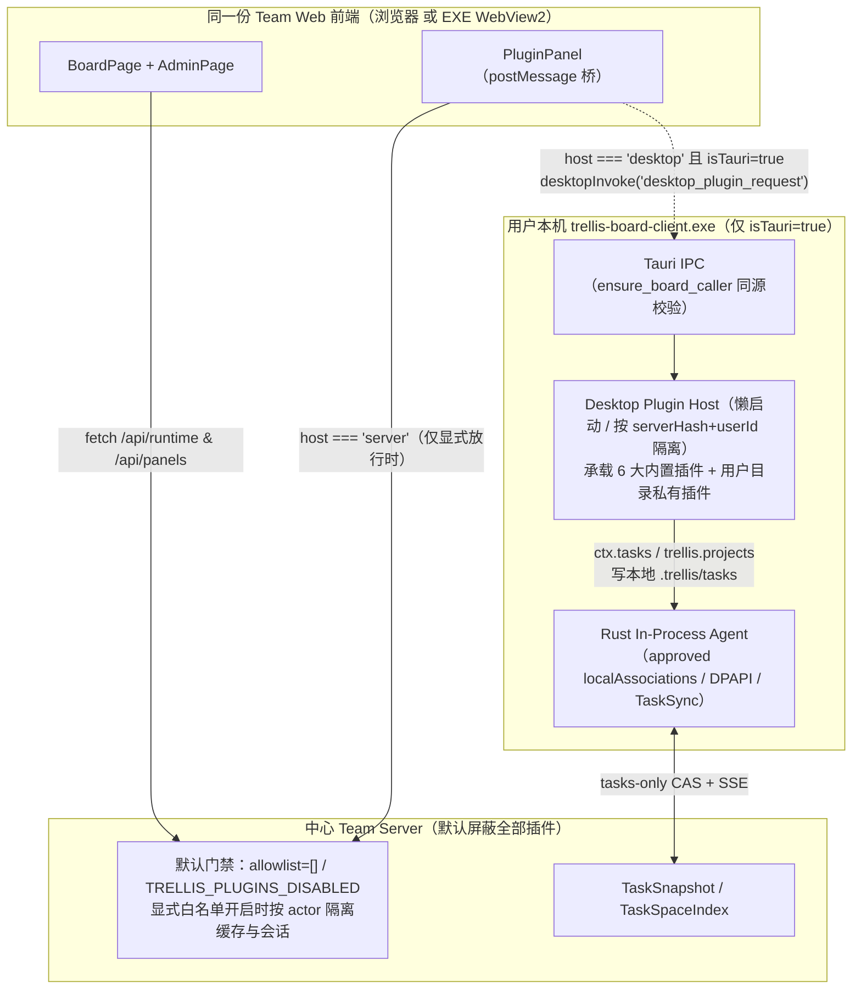

# 技术总设计：团队版主线插件体系改造

## 1. 总体双端架构：Team Server 默认屏蔽 + EXE 本机托管

围绕「中心 Team Server（默认屏蔽插件、Gitless、多租户）+ 桌面 EXE（内嵌远程 Team 网页 + 进程内 Rust Agent + 本机插件宿主）」设计总体边界：

### 核心数据闭环（为什么插件迁入 EXE 天然适配团队版）
1. **写任务闭环**：`witops-core` / `a2a-intake` 等本机插件通过桌面宿主写入已关联仓库的 `.trellis/tasks/**` → 现存 Rust `TaskSync` watcher 250ms 聚合 → CAS 自动上传 Team Server → 全团队网页实时刷新。服务端插件不再需要代理本地 Git 或绕道异步投递。
2. **账号隔离**：不同用户共用同一台公司电脑或同一份绿色包连接同一服务器时，Rust 侧依据当前登录 `(serverUrlHash, userId)` 切换本机插件数据目录与 DPAPI 凭据，切换账号立即销毁旧宿主进程。
3. **浏览器天然屏蔽**：纯浏览器访问远程服务器时没有 `window.__TAURI__`，既看不到本机插件管理入口，也无法触达任何本机端口/文件路径。

## 2. 生产服务器门禁模型（Phase 1）

| 层级 | 控制方式 | 默认行为 | 效果 |
| --- | --- | --- | --- |
| **L0 总开关** | `TRELLIS_PLUGINS_DISABLED=1|true` | `false` | 强制关闭 Team 插件宿主、清空 `/api/panels`、拒绝 `/api/plugins/*`（含 `/app/panel*` 匿名静态资源）与插件 SSE，`features.pluginsEnabled = false` |
| **L1 默认空集合白名单** | `TRELLIS_TEAM_PLUGINS_ALLOWLIST` | **`[]`（默认全屏蔽）** | 未配置环境变量时，Team Server 与 `pluginsDisabled=1` 一致不装载、不启任何子进程；仅运维显式设置如 `witops-core` 时才开放 |
| **L2 前端入口收敛** | `teamMode` + `features.pluginsEnabled` | `BoardPage` 顶栏隐藏单机「插件」 | 普通网页端不展示单机 `<PluginsView />`；Admin 管理页在 `!pluginsEnabled` 时隐藏「插件」Tab |
| **L3 显式放行缓存隔离** | `witops-core` `user:${userId}:` 分区 | 按请求 `actor` 分区 | 即使服务器显式放行 `witops-core`，并发用户之间也不串缓存 |

## 3. 桌面 EXE 本机插件宿主架构（Phase 2）

- **随绿色包携带，按需懒启动**：
  - `packages/desktop/package-portable.ps1` / `tauri.conf.json` 资源打包最小本机宿主入口 + 6 大内置插件源码（剔除 `test/` 等开发文件）；
  - 未启用任何本机插件时**不启动 Node 进程**；启用至少 1 个插件时用环境门探测到的 `node.exe` 启动宿主。
- **通信安全**：
  - 仅通过 stdio 或 `127.0.0.1` 临时端口 + 随机 bearer token 与 Rust 通信（`a2a-intake` 的本地 webhook/JSON-RPC 同样默认仅绑定 `127.0.0.1`）；
  - 所有 Tauri IPC 命令首行执行 `ensure_board_caller(&app, &window)` 同源校验。
- **插件源码覆盖顺序**：延续先查用户目录 `%LOCALAPPDATA%\TrellisBoard\plugins\<id>\`（允许放 `witops-workbench` 等私有插件），再回退随客户端分发的内置插件目录。

## 4. 6 大内置插件极简零配置改造原则（Phase 3）

| 插件 ID | 删减冗余字段方向 | 自动推导上下文 | 用户唯一需填项 |
| --- | --- | --- | --- |
| `accounts-core` | 移除 `systemPresets` 配置要求（内置默认预设） | 凭据存桌面每账号加密 secrets（DPAPI/keyfile） | 内网账号与密码 |
| `witops-core` | 移除 ~25 个前缀/分页/限流/轮询/本地路径字段 | `repositoryId` 与分支取当前关联项目；`baseUrl`/账号可从 `accounts-core` 解析 | WitOps 账号密码（或使用统一账号） |
| `jenkins-ops` | 移除 `verifyTls`/`crumb`/`timeoutMs`/`retries`/`maxLogLines`/`jobFilter`/`views` 等 | 绑定项目关联与默认日志/超时内置 | Jenkins 地址 + 账号密码/Token |
| `acp-dispatch` | 移除全部 13 个超时/并发/权限/会话/工作目录字段 | `cwd` 取任务所属 `localAssociations` `repoPath`；自动探测本机 CLI agent | **零配置，启用即用** |
| `scenario-copilot` | 移除 20+ 个本地目录、大纲及 LLM/重试调优字段 | `workspaceDir` 取关联项目；`outputRoot`/`outlinesDir`/`storageState` 自动落插件用户目录 | 目标测试系统账号 + LLM API Key/模型 |
| `a2a-intake` | 移除强制 `env:A2A_TOKEN` 等必填项，设 `allowMissingSecrets: true` | 首次启用自动生成本地 token；`publicBaseUrl`、`repositoryId`、`defaultAssignee` 全自动推导 | **零配置，启用即用** |

## 5. 兼容性与 Standalone 降级策略

- **Standalone 降级**：不删除 `packages/server/standalone/` 现有源码与测试，但将其标记为 Frozen / Legacy；所有新特性（如本机双通道面板、精简零配置体验）优先面向「Team 服务端 + 桌面 EXE」主线实现，不强制维持与单机版的新增 UI 对等。
- **风险与缓解**：
  - 风险：6 大插件删减 `plugin.json` 字段后老测试（如 `plugin-manifest-conventions.test.js`、`plugins/*/test/manifest.test.js`）可能因断言旧字段而失败 → Phase 3 同步更新清单约定与插件自身单测，并保留对显式传入高级覆盖项的运行时代码兼容（仅从默认 `plugin.json` 模板中精简）。
