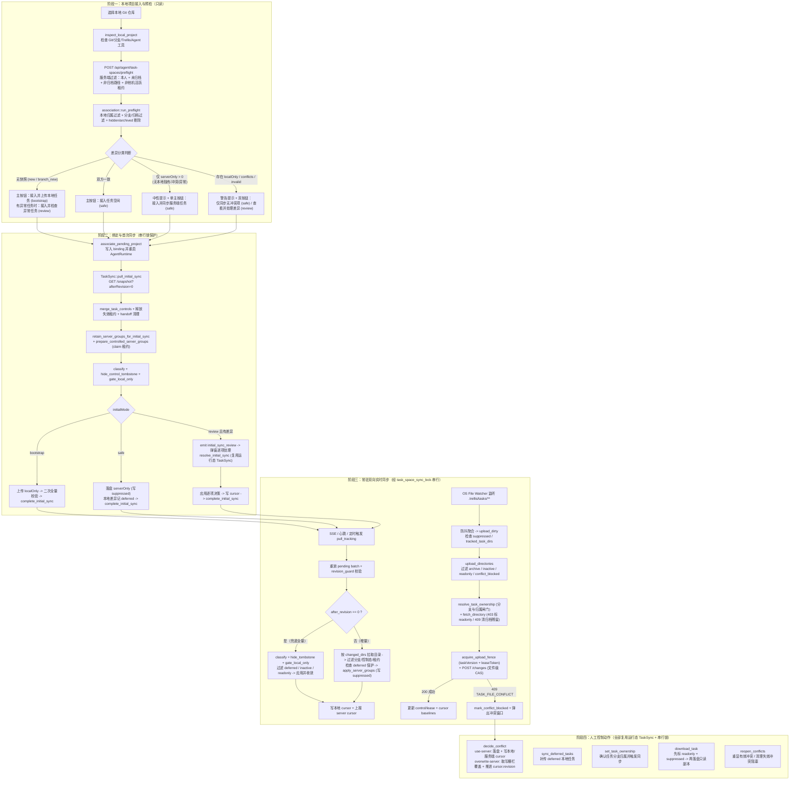

# 技术设计：客户端任务同步一致性修复与接入弹窗优化

## 1. 完整客户端任务同步流程架构图

## 2. 各修复点设计详情

### 2.1 `agent_service.rs` 复用运行态 `TaskSync` 助手（R1）
- 在 `AgentService` 中提取通用辅助方法（例如 `with_task_space_sync` 或 `resolve_task_sync_for_space`），按 `task_space_id` 优先从 `service.running_task_sync()` 获取运行态 `Arc<TaskSync>`：
  - 若运行态存在且 `running.has_binding(task_space_id).await` 为真：获取 `running.task_space_sync_lock(task_space_id).await` 并在持锁期间执行对应操作。
  - 否则回退到 `service.task_sync(api, config.bindings).await` 临时实例执行。
- 统一改造 `decide_live_change`、`resolve_initial_sync`、`sync_deferred_tasks`、`set_task_ownership`、`download_task`、`reopen_conflicts`（`reopen_conflicts` 遍历 `space_ids` 时按单个 `space_id` 分别判断并加锁）。
- 锁重入确认：`resolve_initial_sync`、`sync_deferred_tasks`、`set_task_ownership`、`download_task`、`reopen_conflicts`、`decide_conflict` 内部均不获取 `task_space_sync_lock`（该锁仅由 `runtime.rs` / `watch.rs` 顶层调度与 `agent_service.rs` 持有），无重入死锁风险。

### 2.2 `download_task` 防竞态顺序（R2）
- 位置：`packages/desktop/src-tauri/src/agent/task_sync/local_files.rs`
- 在调用 `write_task_directory` 前：
  1. 解析 `assignee` 并调用 `mark_readonly_dir(task_space_id, &task_dir, &readonly_reason("DOWNLOADED", &assignee))`。
  2. 将即将写入的所有 `files` 注册到 `self.suppressed`（与 `apply_server_groups` 同口径：`absolute_task_path(binding, &file.path) -> Some(snapshot_sha256(&file.content))`）。
  3. 执行 `write_task_directory`。若失败，清除刚写入的 `readonly_task_dirs` 与 `suppressed` 条目并返回原错误。

### 2.3 `pull.rs` `after_revision == 0` 分支补齐过滤（R3）
- 位置：`packages/desktop/src-tauri/src/agent/task_sync/pull.rs`（第 548-600 行）
- `let mut differences = hide_control_tombstone_local_only(...)` 后立即调用 `self.gate_local_only_differences(binding, &mut differences).await?;`。
- 计算 `local_only` 时增加 `.filter(|task_dir| !readonly_dirs.contains(task_dir))`（复用本函数前面已读取的 `readonly_dirs`，并在 `gate_local_only_differences` 可能新增 `readonly_task_dirs` 后重新读取最新 `readonly_dirs`）。

### 2.4 服务端 `preflight` 排除他机活跃租约任务（R4）
- 位置：
  - `packages/server/team/http/routes/agent.js`：调用 `taskSpaces.preflight(agent.userId, body, { agentId: agent.id })`（或把 `agent` / `agentId` 作为可选参数传入，保持既有直接调用 `preflight(userId, input)` 的单测向后兼容）。
  - `packages/server/team/task-space/shared.js`：`preflightFiles` SQL 增加 `NOT EXISTS` 子句，排除在 `sync_task_lease` 中存在 `execution_task_key = t.execution_task_key AND status = 'active' AND expires_at > ? AND (? IS NULL OR agent_id <> ?)` 的任务（传入当前 ISO 时间戳与 `agentId ?? null`）。
  - 同时确认：若 `agentId` 未传（兼容老测试调用），仅排除“有任意他机租约”？不对——若 `agentId` 为 `null` 则无法区分是否本机，此时不过滤租约（`? IS NOT NULL AND l.agent_id <> ?`），只有路由层传入了当前 `agent.id` 时才排除 `l.agent_id <> agentId` 的活跃租约，确保向后兼容且语义精确。

### 2.5 前端接入弹窗区分纯 `serverOnly` 场景（R5）
- 位置：`packages/web/src/features/board/dialogs/ProjectOnboardingDialog.tsx`
- 拆分两个派生状态：
  - `serverOnlySync = preflight?.status === 'existing' && preflight.counts.serverOnly > 0 && preflight.counts.localOnly === 0 && preflight.counts.conflicts === 0 && preflight.counts.invalid === 0`
  - `needsDifferenceReview = preflight?.status === 'existing' && actionableDifferences.length > 0 && !serverOnlySync`
- 渲染分支：
  - `serverOnlySync`：
    - 卡片标题用中性色（如 `服务端有 ${preflight.counts.serverOnly} 个任务待同步到本地`），说明「本地没有待上传任务或内容冲突，接入后将直接同步以下服务端任务。暂不接入不会建立绑定，也不会修改本地文件。」并继续渲染 `<PreflightDifferenceList items={actionableDifferences} />`。
    - 底部按钮：`暂不接入` + 主按钮 `接入并同步服务端任务`（`onClick={() => void associate('safe')}`，busy 时显示 `正在接入…`）。
  - `needsDifferenceReview`：保持原警告卡片与 `暂不接入` / `仅同步无冲突项` / `查看并处理差异`。

### 2.6 `decide_conflict` 收尾 cursor 对称（R6）
- 位置：`packages/desktop/src-tauri/src/agent/task_sync/conflict.rs`
- `use-server` 分支：在 `write_cursor` 之后增加 `self.write_server_cursor(task_space_id, cursor.revision.max(revision)).await?;`（或在 `resolve_conflict` 之后调用，确保服务端记录已追平）。
- `overwrite-server` 分支：从 `result.get("revision").and_then(Value::as_u64)` 读取最新版本号，写入 `revision: Some(cursor.revision.max(next_revision))` 并同步调用 `write_server_cursor`。
